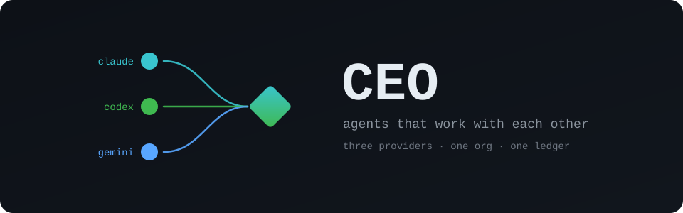
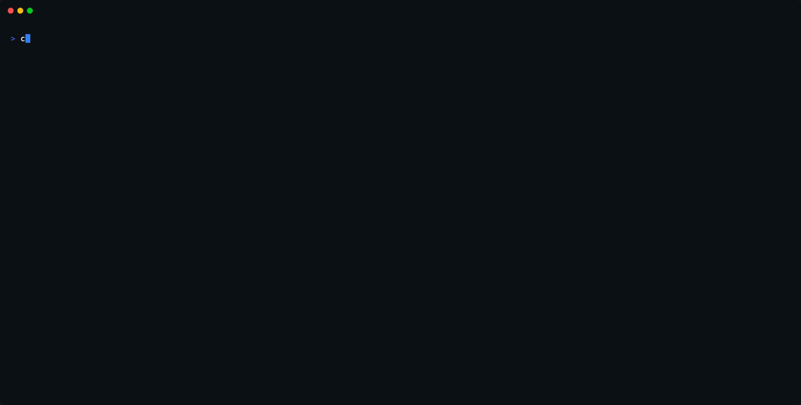
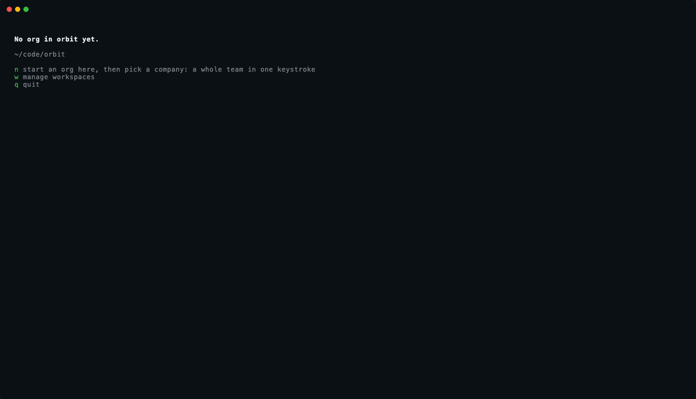
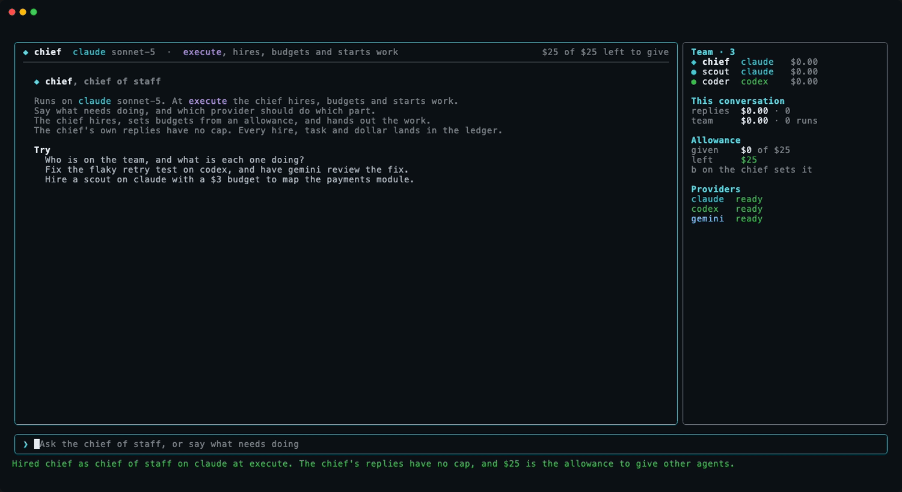
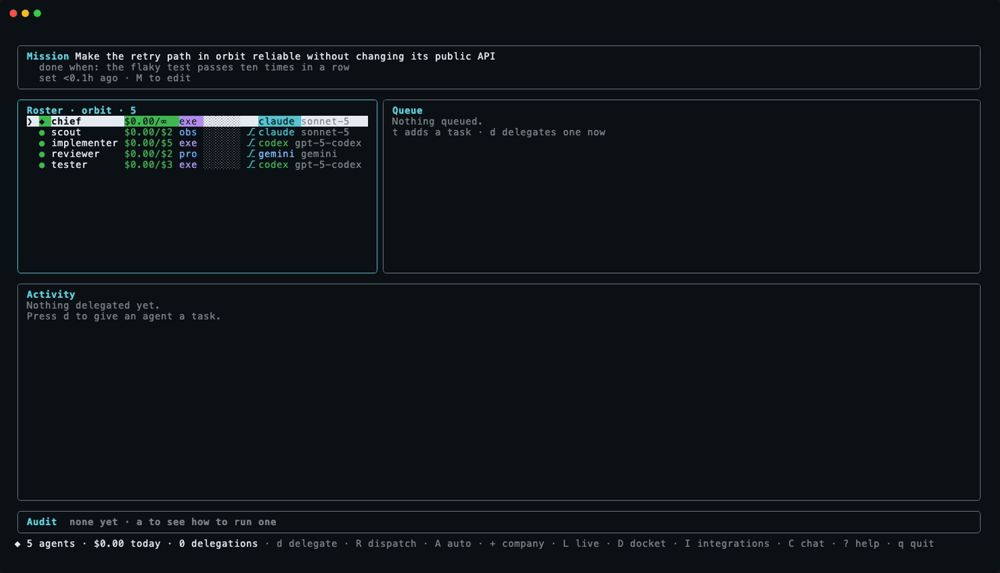
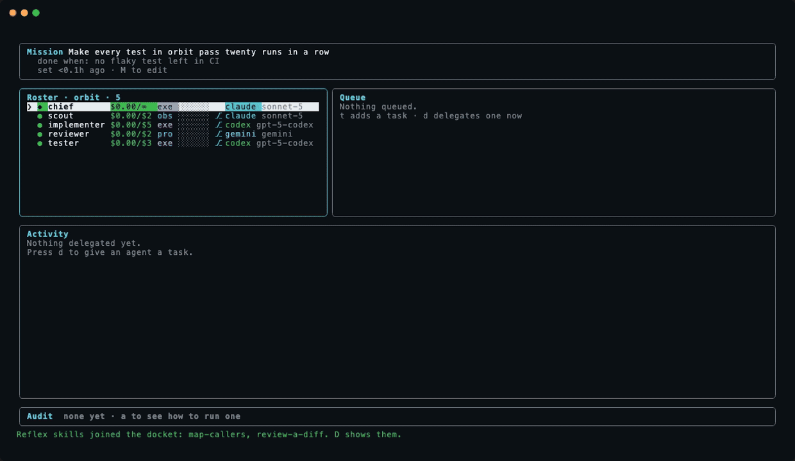
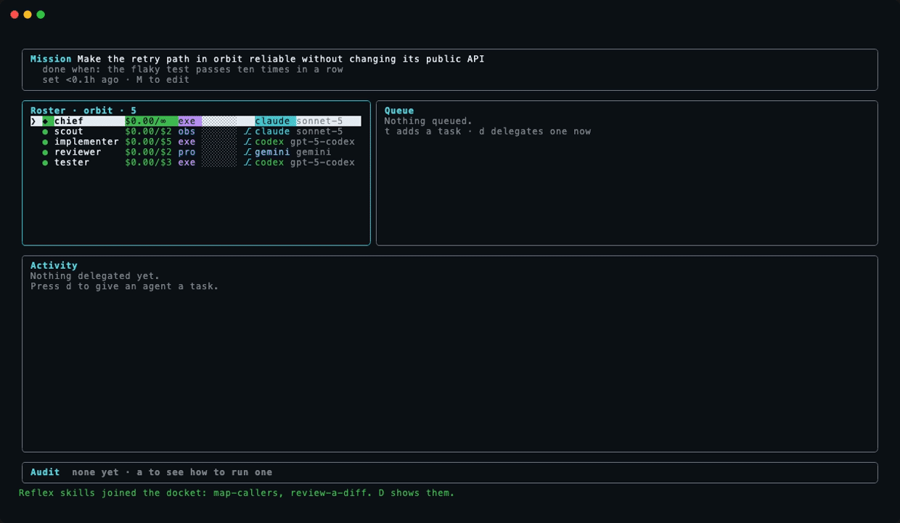
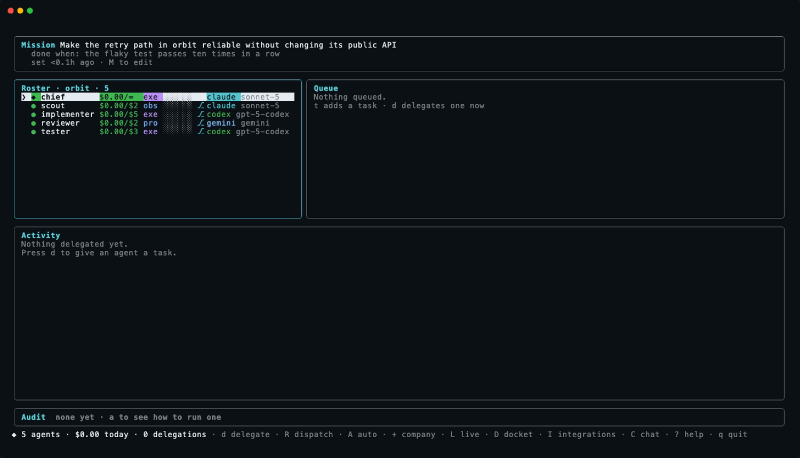
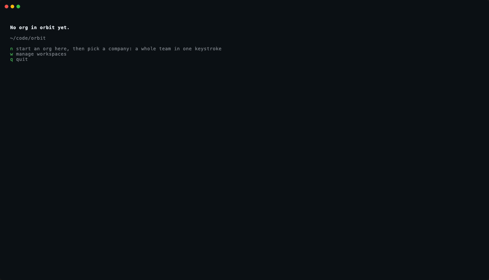

<p align="center">
  
</p>

<p align="center">
  <a href="https://github.com/sumervaid/ceo/actions/workflows/ci.yml"></a>
  <a href="https://www.npmjs.com/package/ceo-tui"></a>
  <a href="LICENSE"></a>
  <a href="docs/README.md"></a>
</p>

<p align="center">
  
</p>

CEO is a terminal dashboard for a company of AI agents on Claude, Codex
and Gemini. A single keystroke hires a whole team. A sentence to the chief
of staff turns into staffed work. The agents then work the task together
across the provider line, and the live view shows every note, review and
handoff the moment the exchange happens. A hash-chained ledger records
each hire, run, note and dollar with the model and the permissions behind
each event.

- **[A company in one keystroke.](#a-company-in-ten-seconds)** Six
  ready-made teams, each mixing providers, with a git worktree per agent
  on request.
- **[A chief of staff to talk to.](#chat-with-the-chief-of-staff)** A typed
  request becomes hires and delegations that start when the reply ends.
- **[Swarms, with limits that pause.](#swarms-and-limits)** Twelve agents or
  two hundred, dealt across providers. A provider limit puts the task back
  in the queue.
- **[A sky of agents.](#the-constellation)** The chief is a black hole. Every
  agent is a star. Every note is a comet.
- **[Evidence, not trust.](#evidence-not-trust)** A task runs as attempts
  across providers. Checks decide which attempt lands.
- **[Three providers, one team, live.](#three-providers-one-team-live)**
  A codex agent hands a fix to a gemini reviewer and reads the review on
  the next turn.
- **[Context and skills per agent.](#the-docket)** Files, issues, model
  cards, papers, notes and Reflex skills, each given to the agents chosen.
- **[GitHub, Hugging Face and alerts.](#integrations)** Issues in, pull
  requests out, model cards as context, and an alert when a run needs a look.
- **[A ledger that cannot be quietly edited.](#state)** Hard caps, settled
  or estimated costs, and a hash chain that names the first bad entry.

**Prior art.** Conductor, Crystal and Vibe Kanban run parallel agents in
worktrees with a task board. herdr is a tmux for agents. None keep a
tamper-evident record of each agent's cost and permissions. None let
agents on different providers work as one team. That record and that team
are the reason CEO exists. The [comparison](docs/comparison.md) has the
table.

## Install

<p align="center">
  
</p>

```sh
npm install -g ceo-tui     # the `ceo` command
brew install tmux          # optional; the dashboard outlives the terminal
ceo setup                  # which of claude, codex and gemini are ready; the account each bills
cd <any directory> && ceo  # the dashboard
```

From source: `git clone https://github.com/sumervaid/ceo && cd ceo && pnpm install && pnpm build && ./install.sh`.

CEO stores no model-provider credential. CEO runs the CLIs already
signed in on the machine. `ceo setup` names the account each CLI bills. A single ready
provider is enough to start. See [setup and accounts](docs/setup.md).

## A company in ten seconds

<p align="center">
  
</p>

```
ceo          the dashboard
n            start an org here; the company picker opens at once
enter        hire the software team: five agents on claude, codex and gemini, then chat with the chief
```

Six companies ship: a software team, a bug squad, a review desk, a docs
studio, a research lab and a full company. Each mixes providers, and each
comes with a chief of staff. The picker shows every seat before the hire:
provider, model, level, budget and worktree, then the total of the budgets. `w`
gives every writer a git worktree and a private branch, every agent one,
or nobody. `←` `→` set the team size: at 8, each seat becomes eight agents.
`+` opens the picker any time. `ceo company <id>` does the same from the
terminal, with `--size n` for the team size. See [companies](docs/companies.md).

## Chat with the chief of staff

<p align="center">
  
</p>

`C` on the dashboard, or `ceo chat`, opens a conversation with the org's
chief of staff. The request is typed in plain words, and may say which
provider does which part. The chief is an agent like any other, hired on
the first visit. Each message is a run, resumed on the same CLI session as
the last.

- **The chief staffs the request.** Each piece goes to the teammate best
  placed for the piece. A new hire on any provider covers a gap. One request
  may hire a swarm.
- **Named providers stick.** "Put the fix on codex and the review on
  gemini" runs each task on the provider named. The agent's own setting
  stays for the next task.
- **The chief budgets the team, not itself.** The chief's replies have no
  cap. An allowance the operator sets is the money the chief may give other
  agents, by hiring or by `org_budget`. A cut returns money to the
  allowance.
- **The work starts when the reply ends.** A task for a busy agent starts
  when that agent's current run settles. The operator's message is the
  authorization for the spend.
- **The transcript draws from the ledger.** Every hire and delegation shows
  above the reply with a live status, so the model cannot misreport one.
- **The chief never writes code.** The chief's own process is read-only on
  every provider. The chief's level decides what the chief may do to the
  org. The org server enforces each rule at call time.
- **The conversation crosses providers.** `ctrl-p` moves the chief to
  another provider. The next message carries a recap of the exchange.

No level lets the chief change a level, or settle a cost. See
[chat](docs/chat.md).

## Three providers, one team, live

<p align="center">
  
</p>

`L` opens the live view. Each provider gets a column, and each agent a card
with the current step, the last tool and the last words. Under the columns
runs the exchanges strip: every note, question, answer and handoff between
agents, each name in the colour of the agent's provider. A green name
beside a blue one is codex talking to gemini.

The org treats every agent the same whichever CLI runs the agent. Agents on
different providers therefore collaborate the same way, with each other.

- **The prompt carries the org.** Every run starts with a "From the org"
  section: notes addressed to the agent, plus each teammate's latest output.
- **Notes land between turns.** A note posted to a running agent arrives
  when the current turn ends. CEO resumes the session with the notes as
  the next prompt. The agent continues with the new information.
- **Traces are live and shared.** Every run streams events to
  `.ceo/runs/`. `org_running` shows an agent which teammates are working
  and what each just did. `org_trace` follows a single teammate live.
- **A question waits for an answer.** `org_ask` puts a question to a
  teammate. A running teammate receives the question at the next turn
  while the asker waits. An idle teammate gets a separate run to answer,
  under the teammate's own budget, a single level deep so questions never
  circle.
- **Work is handed off, not grabbed.** `org_handoff` queues a task for a
  teammate with the requester's name attached.

The exchange in the GIF above, from the ledger:

```
chief        › implementer   delegate  Make the flaky retry test pass ten runs in a row.
scout        › implementer   note      fetchWithRetry has two callers: client.ts:41 and sync.ts:88.
implementer  › reviewer      note      Moved the backoff reset after the last attempt. Ready for a look.
reviewer     › implementer   note      retry.ts:12 still resets on success. Keep the reset in the success branch.
implementer  › reviewer      note      Fixed. Ten straight runs pass.
reviewer     › implementer   note      Approved. Nothing blocking.
```

The scout runs on claude, the implementer on codex, the reviewer on gemini.
The providers are settings, not roles. `v` moves any agent to another
provider. An agent can read, ask, post and hand off. An agent cannot start
a run of the agent's own choosing, change a budget or a level, or settle a
cost. `ceo board`, `ceo runs` and `ceo trace <agent>` show the same
exchange from the terminal. See [collaboration](docs/collaboration.md).

## The constellation

<p align="center">
  
</p>

`O` on the dashboard, or `ceo sky`, draws the org as a sky. The chief of
staff is a black hole at the centre. An accretion disk swirls around the
horizon, faster as more agents work. Every other agent is a star in the
colour of the agent's provider.

- **A working agent spirals in and twinkles.** A waiting agent shows `◌`. A
  finished agent shows `✧`. A failed agent shows `✕`. An idle agent drifts
  on an outer ring.
- **A note is a comet.** The comet leaves the sender and bends around the
  hole on the way to the receiver. A note to everyone is a ripple.
- **Lines join agents that traded notes.** The constellation therefore shows
  who works with whom.
- **A new agent is born at the horizon.** The agent drifts out to an orbit.
- **A crowded sky drops names and keeps stars.** Hundreds of agents fit.

`←` `→` select a star. `enter` opens the agent. `L` switches to the cards.
`C` opens the chat. See [the constellation](docs/sky.md).

## Swarms and limits

A swarm is many copies of one agent, hired in one step, dealt across
providers. Three ways make one:

```
+  then ← →                    the company picker's team size: each seat becomes n agents
ceo swarm fixer 12             twelve agents named fixer-01 to fixer-12, four on each ready provider
"hire twelve fixers across claude, codex and gemini"    a sentence to the chief of staff
```

CEO caps neither the size of the org nor the count of agents running at
once. The ceilings belong to the providers and the machine. A Claude or
ChatGPT plan has a rolling usage window and a weekly cap, shared by every
session on the account. An API key has limits per minute. Each agent is a
node process and an MCP server, a few hundred megabytes together.

A run refused for a rate or usage limit is not a failure. The task goes back
to the queue. The provider waits until the stated reset. With no stated
reset, the provider backs off for 1, 2, 4 minutes and so on up to 30. The dashboard dispatches again when the
limit lifts. The run shows `waiting`. The `limit` alert fires.
`CEO_MAX_RUNNING=8` sets a ceiling on runs at once, for a machine or a plan
with little room. `CEO_CHIEF_MAX_HIRES` sets a ceiling on hires per chief
reply. See [swarms and limits](docs/swarms.md).

## Evidence, not trust

A task can carry checks. A task with checks, or with several attempts, runs
as attempts. Each attempt is the assignee on one arm, in a separate
worktree. An arm is a provider and a model. The attempts run at the same time.
Each finished attempt is then verified.

A check is a shell command, an Everval collection or a vote of judges.
Judges are agents at observe on other providers. A check that cannot run is
an error. An error is never a pass. The passing attempt with the best score
is promoted. A task with checks reaches done only through a promotion. One
dissent is kept beside the winner: the best attempt from another arm.

```
ceo task add coder "Fix the flaky retry test" --verify "npm test" --verify "judge:the change is minimal" --samples 3
ceo run <task>                          three attempts, each verified, one promoted
ceo approvals                           what waits for a decision, with the evidence
ceo router pick "Fix the crash in login" -n 3    the arms the evidence favours
ceo outcomes                            verified results, and dollars per verified result
```

<p align="center">
  
</p>

Gates decide which actions land. A merge lands alone only when four
conditions hold. The attempt passed. A deterministic check passed. Every
judge agreed. The org setting allows auto-merge. The setting is off by
default. A push, a pull request, a release, a message to a person and a
payment always wait for a person. `V` opens the requests with the evidence
behind each.

Every verdict feeds the router. The router keeps a record of passes per arm
for each kind of work. Thompson sampling draws the next arms from that
record. Strong arms win most draws. Arms with thin records still get tries.
The chief of staff reads the same record through `org_router`.

Outcomes are the budget unit. The status bar shows `N verified · $X/verified`.
A workspace can cap attempts and set a verified target. A workspace with a
lower cost per verified outcome gets more dispatch slots. Agent budgets
still cap dollars.

`CEO_SANDBOX=docker` runs each turn in a container that is discarded when the
process exits. Autonomy is still enforced by the agent's own process.

The loop closes outside CEO. Reflex is getting a CEO source adapter. The
adapter reads `.ceo/runs` and treats `verify` events as reward. A new Reflex
skill then becomes an arm that the router can try. Reflex reads CEO's runs
and verdicts. Everval grades the collection that a check names. See
[verification](docs/verification.md), [judges and gates](docs/gates.md),
[the router](docs/router.md), [outcomes](docs/outcomes.md) and
[sandboxes](docs/sandboxes.md).

## The docket

<p align="center">
  
</p>

`D` opens the docket: every piece of context in the org, and who holds
which. Context runs down the side, agents across the top in the colours
of the providers. `space` gives an item to the agent under the cursor.
`n` adds an item from one input line that reads a path, a folder, `#42`,
`hf:org/model`, `paper:2408.01234`, a URL, `skill:name` or a note.

- **Each agent reads a separate docket.** A run starts with the items the
  agent holds, in the agent's prompt, on every provider.
- **Skills come from Reflex.** The catalogue reads every SKILL.md Reflex
  wrote and every skill installed for Claude Code, Codex or Cursor. A
  workflow Reflex is still waiting on is approved when picked.
- **Files are fresh, the rest is a snapshot.** Files are read from the
  agent's own branch when the run starts. Issues, cards, papers and pages
  are snapshotted when added, so the agent reads what the operator saw.
- **The chief of staff uses the docket too.** "Give the reviewer issue 42
  and the backoff paper" works in the chat.

A row under the grid totals what each agent reads, against a limit. See
[the docket](docs/docket.md).

## Integrations

<p align="center">
  
</p>

`I` opens one screen for GitHub, Hugging Face, alerts and Reflex skills.
GitHub goes through the `gh` login. Hugging Face reads the token that
`hf auth login` saved, or `HF_TOKEN`. Slack and webhook URLs live in
`~/.ceo/alerts.json`.

- **GitHub through `gh`.** `ceo setup github` signs in once. Open issues
  go to an agent as context, to the queue as tasks, or to the chief of
  staff. `P` on the roster pushes an agent's branch and opens a pull
  request whose body is the ledger's account of the work and the cost.
- **Hugging Face with no setup.** Public models, datasets, Spaces and
  papers become context in one line. A token from `hf auth login` adds
  private repos.
- **Alerts where the developer is.** A failed run, a refusal at a budget,
  an agent reaching past the agent's level, a reply from the chief, an empty
  queue, a provider limit. The bell, the desktop, Slack or any webhook. `t` sends a test.

See [integrations](docs/integrations.md).

## A suggested team, with evidence

<p align="center">
  
</p>

`p`, or `ceo suggest`, proposes seats from three kinds of evidence. No
model is called to do so:

1. **Reflex workflows.** [Reflex](https://github.com/sumervaid/reflex-tui)
   scans Claude Code, Codex and Cursor history on the machine. Reflex finds
   the workflows a person keeps repeating, with the steps that worked and
   the corrections the person kept giving. Each workflow becomes a seat.
   The steps are the brief. The corrections are guardrails. The token mix
   sets the cap.
2. **Session history.** Which models have run in this directory, how often
   those sessions ended verified, what a session costs.
3. **The repository.** Manifest, test runner, CI and docs decide which
   standard roles earn a seat. The repo's commands go into those briefs.

Enter opens the hire form filled in, ready to read, change and hire. When
Reflex has not scanned, `s` runs the scan from the panel. Runs on claude
and codex leave transcripts where Reflex reads. Those runs become evidence
for the org's next hire. Reflex does not read gemini transcripts yet. See
[the suggested team](docs/suggest.md).

## Every key

```
n  +         start an org; start a company
D  I         the docket; integrations: GitHub, Hugging Face, alerts, skills
C            chat with the chief of staff
L            the live view: every agent by provider, and the exchanges between agents
O            the constellation: every agent a star around the chief of staff, every note a comet
p  h         a suggested team; hire by hand
t  d         queue a task, with checks and attempts; delegate now
R  A         dispatch every idle agent; auto-dispatch across every workspace
V            approvals: merges and outward actions waiting on a decision
v  i         move the selected agent to another provider; give the agent a worktree
b  y  m      budget; level; merge the agent's branch
P            push the agent's branch and open a pull request
?            every key, inside the dashboard
```

## Providers and permissions

The provider decides how a run happens. The level decides what the run may
do. The provider's own process enforces the level. Neither decides what an
agent is for.

| | **claude** | **codex** | **gemini** |
| --- | --- | --- | --- |
| Runs as | `claude -p --output-format stream-json` | `codex exec --json`, task on stdin | `agy -p --output-format stream-json`, the Antigravity CLI |
| Brief | `--append-system-prompt` | `developer_instructions` | ahead of the task in the prompt |
| Level enforced as | a tool allowlist, `--allowed-tools` | a filesystem sandbox, `--sandbox`, approvals never | `--mode plan` below execute; `--mode accept-edits` above, with approval for commands |
| Denial signal | `permission_denials` in the result | a command the sandbox refused | a tool refused for want of approval |
| Cost | settled `total_cost_usd` from the process | tokens only, costed from list prices, marked `est.` | tokens only, costed from list prices, marked `est.` |
| Bills | the Claude Code login | the `codex login`, ChatGPT plan or a metered key | the Google account through `agy`, or a metered Gemini key |

| Level | May | claude | codex | gemini |
| --- | --- | --- | --- | --- |
| `observe` | read and report | Read, Grep, Glob, WebFetch, WebSearch | read-only | plan |
| `propose` | read, run commands, draft a change | + Bash | read-only | plan |
| `execute` | write on a branch of the agent's own; a human merges | + Write, Edit, NotebookEdit | workspace-write | accept-edits |
| `autonomous` | write and merge unattended | same as execute, plus merge rights | workspace-write | accept-edits |

`isolated` gives an agent a separate git worktree on branch `ceo/<name>`.
Commits carry provenance trailers. `git log` alone therefore says which
agent wrote a line, under which run, at what cost. `m` merges a branch. The
run pane's `grants` line shows exactly what each run was started with. See
[providers](docs/providers.md) and [autonomy](docs/autonomy.md).

## Money

Budgets are hard caps, checked before anything is spent, whichever path
asked for the run. Spend is recomputed from the ledger on every read. A run
that spent money never settles at $0. A cancelled claude run is costed from
the streamed tokens. Every codex and gemini run is costed from the reported
tokens. Both are marked as estimates. Sub-cent spend prints with four
decimals everywhere. `ceo billing` names the account each provider draws
on. A metered key is a yellow warning on the hire form. See
[money](docs/money.md).

## The queue

<p align="center">
  
</p>

A task is a ledger object. A task exists before any run starts. A task
survives a run that failed. Blocked is derived, never stored: unassigned,
assignee not in the org, or assignee at the cap. Raising a budget unblocks
every task the raise should unblock. A task links to the run by id. The
task's cost comes from the ledger. `R` runs a single dispatcher pass. `A`
runs a loop across every registered workspace. `A` shows in inverse yellow
because the loop spends without a keystroke per dollar. See
[the queue](docs/queue.md).

## The command line

```
ceo                    the dashboard in tmux session `ceo`, or in the current terminal without tmux
ceo setup [provider]   are claude, codex and gemini installed and signed in; run a login
ceo suggest            propose a team; --hire, --json, --everywhere, --days N, --scan
ceo chat               the dashboard, opened on the chat with the chief of staff
ceo runs · ceo board   who is working now, and every note between agents
ceo sky                the constellation, opened on the dashboard
ceo company [id]       hire a whole company; no id lists the companies; --worktrees writers|all|none, --size n
ceo swarm <name> <n>   n copies of one agent across providers; --brief, --providers, --budget, --level, --task
ceo docket · ceo skills   the context and skills each agent is given
ceo github · ceo pr <agent> · ceo hf <repo>   issues, pull requests, Hub cards
ceo alerts [test]      where alerts go: the bell, the desktop, Slack, a webhook
ceo agent <name> provider <p> [model]   move an agent to another provider
ceo task add coder ! fix the flaky test   queue (! high, . low); ceo task ls; ceo task <id> done
ceo task add <agent> <title> --verify "<check>" --samples n --arm provider[:model] --sandbox docker
ceo run <task> [--samples n]   run a task now as attempts, verify each, keep the winner
ceo verify <check> · ceo mission [checks|check]   one check now; the mission's checks
ceo approvals [approve|deny <id>|auto-merge on|off]   the requests that wait for a decision
ceo router [kind] · ceo router pick "<title>"   which arm wins a kind of work
ceo outcomes [--all] [budget …]   verified results and dollars per verified result
ceo sandbox [test]     where runs execute and whether the sandbox can start
ceo post <agent|*> <text>   a note; ceo board shows the board
ceo trace <agent>      what one agent is doing, line by line
ceo workspace add <path>   the sidebar's list of directories
ceo snapshot · ceo status · ceo billing · ceo shell [agent]
ceo json · ceo op <verb> <json>   the org as JSON; a single mutation through the core
```

See [the command line](docs/cli.md).

## State

```
~/.ceo/workspaces.json      the list of directories, nothing else

<dir>/.ceo/
├── roster.json             cache; the ledger is authority
├── ledger.jsonl            append-only, hash-chained
├── audits/<ts>.md          auditor reports
├── outputs/<id>.md         archived run outputs
├── runs/<id>.jsonl         live traces
├── context/<id>.md         docket snapshots: issues, cards, papers, pages, notes
├── chief/<name>/           a chief of staff's directory on gemini
└── worktrees/<name>/       checkouts of isolated agents
```

Commit `roster.json`, `ledger.jsonl`, `audits/` and `context/`. Gitignore
`worktrees/`, `outputs/`, `runs/` and `chief/`. `verify()` walks the chain and names the first bad
entry. The dashboard shows a red banner until the chain verifies again. An
org does not need a git repository. Git matters only for `isolated`. See
[the ledger](docs/ledger.md).

## Optional: the Claude Code companion

The repo is also a Claude Code plugin: 16 slash commands and 29 `ceo_*`
MCP tools that write to the same ledger under the same lock. `./install.sh`
links the plugin. Nothing above needs the plugin. Audits, through
`/audit`, currently do, because the auditor is a Claude Code subagent.

## Documentation

The [docs](docs/README.md) folder is the wiki: [getting started](docs/getting-started.md),
[setup](docs/setup.md), [concepts](docs/concepts.md), [companies](docs/companies.md), [chat](docs/chat.md), [collaboration and the live view](docs/collaboration.md),
[the constellation](docs/sky.md), [swarms and limits](docs/swarms.md),
[verification](docs/verification.md), [judges and gates](docs/gates.md), [the router](docs/router.md),
[outcomes](docs/outcomes.md), [sandboxes](docs/sandboxes.md), [the docket](docs/docket.md), [integrations](docs/integrations.md),
[providers](docs/providers.md), [autonomy](docs/autonomy.md), [the queue](docs/queue.md),
[the ledger](docs/ledger.md), [money](docs/money.md), [keys](docs/keys.md),
[command line](docs/cli.md), [the suggested team](docs/suggest.md), [testing](docs/testing.md),
[troubleshooting](docs/troubleshooting.md), [FAQ](docs/faq.md), [compared to](docs/comparison.md).
Maintainers start with [ARCHITECTURE.md](ARCHITECTURE.md).

## Developing

Nothing in the repo calls a model. `tools/stub-claude`, `tools/stub-codex`
and `tools/stub-gemini` speak each CLI's protocol, and `tools/stub-org.mjs`
lets a stub post notes through the real org server. `CEO_REQUIRE_STUBS=1`
makes the runner refuse anything else. `tools/keydrive.py` drives the
dashboard under a real pty. Read [ARCHITECTURE.md](ARCHITECTURE.md) before touching `src/core/`.

```
pnpm build && pnpm typecheck && pnpm test
pnpm demo:all          # re-record every GIF on this page against the $0 fixture
```

## License

MIT.
