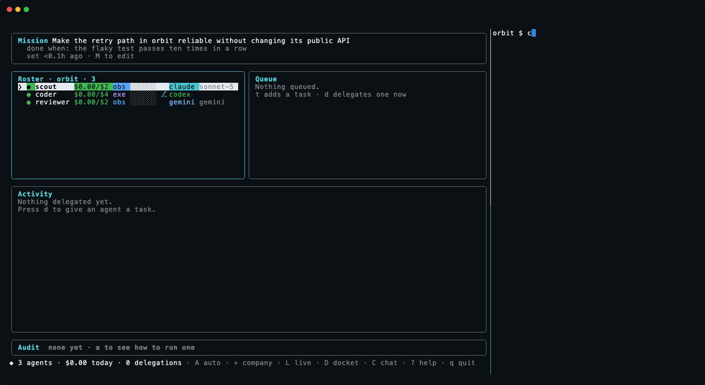

# Collaboration

Agents work with each other through the org, not around the org. Inside the
org there is no provider line. Every agent is a name, a brief, a budget, a
level and a provider setting. The same notes, questions, traces and
handoffs connect any two agents whatever provider runs the two. No vendor's session
sees another's. The exchange happens in the ledger. An agent can do three
things during a run. Each is a ledger event carrying the agent's name:

| Action | Tool | Writes |
| --- | --- | --- |
| Leave a note for a teammate, or for the whole org | `org_post` | a `note` of kind `message` with `from`, `to`, `text` |
| Hand work to a teammate | `org_handoff` | a `task_add` with `requestedBy` |
| Read the roster, the mission, teammates' outputs, the board | `org_roster`, `org_mission`, `org_outputs`, `org_read_output`, `org_board` | nothing |

What an agent still cannot do, by omission: start a run, change a budget
or a level, close a cost record, or mark a task done. An agent can ask for
work. An agent cannot pay for work, including the agent's own.

## How the org reaches the agent

**In the prompt.** Every compiled prompt gets a "From the org" section when
the org has content for the agent: notes addressed to the agent or to the
whole org since the agent's last run, with up to three older notes, and each
teammate's latest completed output, truncated. The section sits before the
autonomy section. The agent reads the section as context. The level and the
guardrails still come last. A provider with no tool access still gets this
section.

**As tools.** CEO starts a small MCP server, `org`, for each run, told
which agent is running. On claude the server is passed with `--mcp-config`.
The server's ten tools are added to the allowlist. `--strict-mcp-config`
keeps the machine's own MCP servers out of an agent's run. On codex the
server goes in through config overrides. On gemini the Antigravity CLI reads
MCP servers from a file in the workspace. The server is therefore written
into an isolated agent's worktree. A non-isolated agent on gemini gets the
prompt side only.

The run's `grants` line and the ledger's `delegate_start` entry both say
`org tools (10)` when the surface is on. `CEO_NO_COLLAB=1` turns the surface off.

## The live view

<p align="center">
  
</p>

`L` on the dashboard opens the live view. Each provider gets a column.
Each agent gets a card: the task, the turn and the elapsed time, the last
tool, the last line the agent wrote. Under the columns runs the exchanges
strip. Every note, question, answer and handoff between agents appears
there, oldest first, each name in the colour of the agent's provider. A
note from a codex agent to a gemini agent reads green to blue on one line.
`C` from the live view opens the chat. `esc` returns to the dashboard.

<p align="center">
  
</p>

The recording above shows the same path from the shell. A note posted with
`ceo post` lands in a running agent as the next turn.

## Live: traces, notes between turns, questions that wait

A run is a sequence of turns on one CLI session, not one shot. Every event
of every run is appended to `.ceo/runs/<id>.jsonl` as the event happens.
The live tools read that file:

| Tool | Does |
| --- | --- |
| `org_running` | the agents working right now, each agent's task, turn and last few lines |
| `org_trace` | a teammate's current run as the run happens, or the teammate's latest run: the text the teammate said, the tools the teammate used |
| `org_ask` | put a question to one teammate and wait for the answer |

**Notes arrive between turns.** When an agent's turn ends after teammates
have posted since the prompt was built, CEO resumes the same session with
`claude --resume`, `codex exec resume` or `agy --conversation`. The notes
become the next prompt: "While you were working, teammates posted: …
Continue the task with this in mind." The agent carries on with the new
information. A run takes at most six such turns by default. `CEO_MAX_TURNS`
changes that limit. No turn runs past the agent's budget. The pane shows
`turn 2`. The ledger's `delegate_end` records `turns`.

**A question waits for the answer.** `org_ask` posts the question as a
note with an ask id. If the teammate is running, the question reaches the
teammate at the next turn. The asker waits, polling the board, up to three
minutes by default. If the teammate is idle, CEO starts a run for the
teammate to answer, under the teammate's own budget and level, with the
parent run recorded on the ledger entry. The asked run is one level deep and
may not ask onward. That limit is what stops two agents paying each other to
think in circles.

```
coder   org_ask scout "where is parse() called from?"
        → scout is idle: a scout run starts, answers, settles against scout's cap
scout   org_post coder --inReplyTo 3f1a "client.ts:41, retry.ts:12, cli.ts:88"
coder   (next turn) continues with the answer
```

This is collaboration on one task. The implementer asks the scout mid-task.
The implementer has the reviewer look at a diff before committing. Every
exchange is a ledger event with an author, a cost and a parent.

## What a handoff is

A task in the queue, assigned to the teammate, with `requestedBy` set to
the agent that asked. The task shows in the queue as `· from scout`. The
task runs on `enter`, when `R` dispatches, or when auto-dispatch picks the
task up, under the teammate's own budget and level. An agent cannot make
another agent spend. An agent can only put work where a person or the
dispatcher will see the work.

## The board

`ceo board` prints the notes, newest first. `ceo post <agent|*> <text>`
leaves a note from the person at the keyboard. The note reaches the agent
at the start of the agent's next run. The activity panel shows notes in the
feed, marked `✉`, between the runs the notes happened around.

```
ceo post coder "retry.ts first; the flaky path is the one with the backoff"
ceo board
```

## Writing a brief that uses the org

The prompt tells every agent what the tools are and when each applies. A
brief makes the guidance specific:

> When you find a defect you are not permitted to fix, hand it to `coder`
> with the file and line, and say so in your report.

> Before you start, read the scout's latest output with org_outputs.

The collaboration field on the hire form is the place for the teammates the
agent defers to and the work the agent hands off. The tools are the means.

## The chief of staff

One agent holds eight more tools. That agent is the chief of staff, the
agent the [chat](chat.md) talks to. Five tools staff the org:
`org_providers`, `org_hire`, `org_budget`, `org_delegate` and `org_fire`.
Three tools work the docket: `org_docket`, `org_context` and `org_give`.
The chief's level decides which of the eight the chief may use. The org
server checks the level, the allowance and the per-reply limit on every
call. No other agent's server registers the eight tools.

## What this is not

Agents do not share a context window. A note cannot interrupt a turn
in progress. A note arrives at the boundary, the way a message reaches a
person between meetings rather than mid-sentence. Each run is still one
session with one task. The surface is a board, a queue and the traces, all
under `.ceo/`. That is what lets the auditor say later which agent asked
which teammate for what, and the cost of the exchange.
