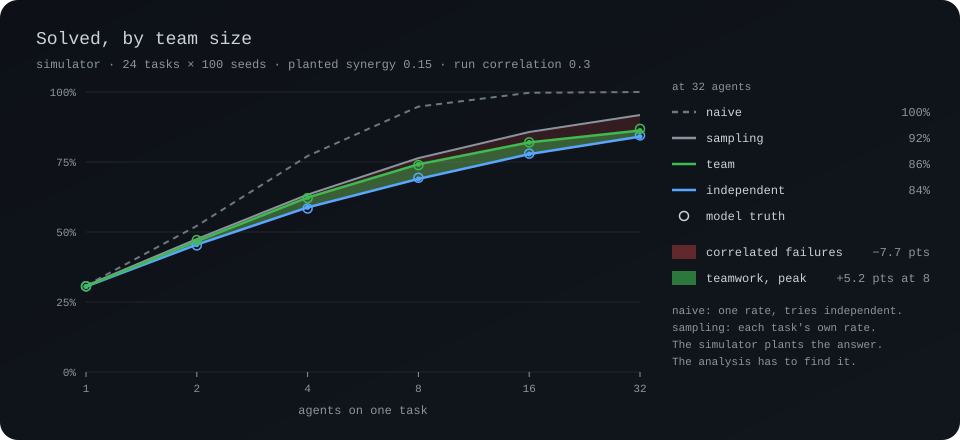

# Experiments

More agents solve more tasks. That fact alone says nothing about teamwork.
Eight independent attempts beat one attempt with no coordination at all.
The interesting questions start after that. How much of the curve is
sampling? Where does the curve bend? What bends the curve?

`ceo experiment` answers those questions with a designed experiment. A spec
names conditions, team sizes, seeds and tasks. Every combination is a cell.
Each cell runs in a fresh root with a ledger of its own. The ledger is the
raw data. The export flattens every ledger into two tables. The report
splits the curve into sampling and teamwork.

<p align="center">
  
</p>

`pnpm demo:teamwork` runs `tools/demo/teamwork.json` and redraws the chart.

```
ceo experiment new scale             # write scale.json, a starter spec
ceo experiment plan scale.json       # cells, attempts, binaries, budget
ceo experiment run scale.json        # run every unfinished cell, then report
ceo experiment report scale          # the report again, from the ledgers
ceo experiment export scale          # cells.csv and attempts.csv
```

## Two backends

**sim** draws attempts from a model with known parameters. A run costs
nothing. A thousand cells take a second or two. The answer is known in
advance. That is the point. The analysis runs on planted effects and has to
recover them. An analysis that misses a planted effect cannot be trusted
with a real one.

**ceo** runs the real path. Each cell gets a git repo copied from the
task's fixture, an agent, a task with checks, and `runTask`. With stubs on
PATH, the run is free and exercises every part of CEO. With real CLIs, the
run costs money. A real run needs `--live` and `budgetUsd` in the spec.
`ceo experiment plan` names the binary each provider resolves to, and
whether that binary is a stub.

## The spec

```json
{
  "name": "scale",
  "backend": "sim",
  "sizes": [1, 2, 4, 8, 16, 32],
  "seeds": 5,
  "conditions": [
    { "name": "independent", "mode": "independent" },
    { "name": "team", "mode": "team" }
  ],
  "tasks": [{ "id": "t01" }, { "id": "t02" }, { "id": "t03" }],
  "sim": { "runCorrelation": 0.3, "team": { "synergy": 0.15, "conflictRate": 0.02 } }
}
```

| Field | Meaning |
| --- | --- |
| `name` | The experiment's directory under `.ceo/experiments/`. |
| `backend` | `sim` or `ceo`. Default `sim`. |
| `sizes` | Team sizes. Each size is a number of attempts at one task. |
| `seeds` | Replicates per size, task and condition. |
| `conditions` | Each has a `name`, a `mode` and an optional `provider`. Mode `independent` runs attempts that never see each other. Mode `team` runs attempts that work together. A `provider` keeps every attempt on that provider's arms. |
| `tasks` | Each has an `id`. A ceo task also has a `prompt`, a `fixture` directory, `verify` checks and optional `holdout` checks. A sim task may set a `difficulty` on the logit scale. |
| `arms` | ceo only. The provider and model pairs that attempts rotate through. |
| `agent` | ceo only. The provider, model and role brief of the agent each cell hires. |
| `budgetUsd` | No new cell starts once this much is spent. Required for `--live`. |
| `seed` | The root seed. Every draw in a sim cell derives from the root seed. |
| `sim` | The simulator's parameters. The next section lists each one. |

Checks use the same forms as `ceo task add --verify`: a shell command,
`everval:<collection>#<scenario>` or `judge:<rubric>`.

The `verify` checks pick the winner. The `holdout` checks score the pick.
Selection never sees the held-out checks. A best-of-N that only learned to
pass the visible tests then shows as a gap between solved and held-out pass.

The ceo backend runs independent conditions. Team conditions run on the sim
backend for now.

## The simulator

For cell c, task j, arm k and attempt i:

```
p(j,k)  = logistic(ability(k) - difficulty(j) + u(j,k))
z(i)    = sqrt(rho) * v(c) + sqrt(1 - rho) * e(i)
pass(i) = Phi(z(i)) < p'(j,k)
```

On its own, an attempt passes with probability p. The term u(j,k) is fixed
per task and arm. Some arms are better at some tasks. That spread is what
makes mixing providers pay. The draw v(c) is shared by every attempt in one
run. A run goes well or badly as a whole. The correlation rho sets how
much.

A team changes three things. The threshold p' adds a synergy term on the
logit scale, growing with log2 of the team size. A pass can be undone by a
conflict with a peer. Every attempt pays minutes and dollars per peer for
coordination.

| Parameter | Default | Meaning |
| --- | --- | --- |
| `arms` | claude, codex, gemini | Each with `ability`, `costUsd` and `minutes`. |
| `taskMean` | 1.5 | Mean task difficulty, for tasks that give none. |
| `taskSpread` | 1.2 | Spread of task difficulty. |
| `armTaskSpread` | 1.0 | How much an arm's skill moves from task to task. |
| `runCorrelation` | 0.3 | Correlation between attempts in one run. |
| `overfit` | 0.1 | The chance that a visible pass fails the held-out checks. |
| `maxRunning` | null | Attempts running at once. Others queue. |
| `team.synergy` | 0.15 | Logit added per doubling of team size. |
| `team.conflictRate` | 0.02 | The chance, per peer, that a pass is undone. |
| `team.overheadMinutes` | 0.5 | Minutes added to each attempt per peer. |
| `team.messageUsd` | 0.02 | Dollars added to each attempt per peer. |

Random numbers are common across conditions. Cell (size, seed, task) draws
the same v and e in every condition. A difference between two conditions is
then the effect of the condition, not the luck of the draw. A team with no
synergy, no conflicts and no overhead reproduces the independent condition
draw for draw. A test holds the simulator to that.

## The report

```
conv · sim backend · 6 tasks × 400 seeds · 14400 cells · 100800 attempts
planted · runCorrelation 0.4 · armTaskSpread 1 · taskSpread 1.2 · synergy 0.3 · conflictRate 0.03 · overfit 0.1

independent · one try solves 16.6%
  size   naive   sampling   observed   model   correlation   effective tries
     1   16.6%   16.6%      16.7%      17.2%   +0.0 pts      1.0
     4   51.7%   49.8%      43.8%      43.3%   -6.0 pts      3.2
    16   94.6%   82.2%      66.5%      68.1%   -15.8 pts     6.0

team · one try solves 16.6%
  size   naive   sampling   observed   model   gap        effective tries   vs independent           model
     1   16.6%   16.6%      16.7%      17.2%   +0.0 pts   1.0               +0.0% [+0.0%, +0.0%]     +0.0%
     4   51.7%   49.8%      54.3%      53.9%   +4.5 pts   4.3               +10.5% [+8.8%, +12.4%]   +10.6%
    16   94.6%   82.2%      80.3%      81.1%   -1.9 pts   8.9               +13.8% [+9.5%, +18.3%]   +13.0%
```

Each column answers one question.

- **naive.** One pooled single-attempt rate p, and 1 - (1 - p)^N. The curve
  if every task were alike and every try independent.
- **sampling.** The same idea with each task's own rate for each arm the
  cell ran. The rates come from the pooled independent attempts. The
  estimate is the unbiased pass@k form. Easy tasks fall to one try. Hard
  tasks fall to none. The gap from naive to sampling is task
  heterogeneity.
- **observed.** What the cells did.
- **model.** Sim only. The exact rate the planted parameters imply, from an
  integral over the shared draw. Observed should sit near the model, inside
  the interval. This column is the check on the analysis itself.
- **correlation.** Observed minus sampling, for an independent condition.
  Below zero, attempts in one run fail together beyond what the task and
  the arm explain.
- **vs independent.** For a team condition, team minus the matching
  independent condition, paired cell by cell. This is coordination. The
  model column beside the interval is the planted value.
- **effective tries.** The number of independent tries at the pooled rate
  that would match the observed rate. Sixteen correlated attempts above
  were worth six independent ones.

Brackets are 95% percentile intervals from a bootstrap over tasks. Tasks
are the unit that varies most. Tasks are also the unit a reader generalises
over. A report from three tasks has wide brackets. The width is honest.

The report then lists cost per cell, cost per solved task, the median
minutes to the first verified attempt, and the held-out pass rate. The last
section names where the curve bends. The bend is the step after which gain
per doubling falls most. The step's gain is split into what sampling
predicts, what coordination moved, and the rest.

## Resume, budgets and safety

Cells run seed by seed. A run cut short by a budget, a provider limit or
Ctrl-C leaves whole replicates. The next `run` skips every finished cell. A
changed design refuses to mix with old cells. `--fresh` starts over. A
changed budget is not a changed design.

A cell refused by a provider limit is left unfinished. The run stops with
the reason. The next run retries that cell.

Each ceo cell is a git repo of its own. `GIT_CEILING_DIRECTORIES` keeps git
from climbing out of a cell into a repo above. Every ceo cell checks that
CEO resolves the cell as its own root before writing. A sim cell writes its
ledger straight into its own directory with no root lookup at all.

With `CEO_REQUIRE_STUBS=1`, a real binary is refused outright. Without the
variable, a ceo run with any real binary needs `--live` and a budget.

## The tables

`cells.csv` has one row per cell: condition, mode, size, seed, task,
solved, attempts, passing, minutes to first, minutes to settle, cost and
held-out pass. `attempts.csv` has one row per attempt: provider, model,
start and end in minutes from the cell's start, cost, outcome, pass,
conflict, promoted and held-out pass. Both load into R or pandas as is.

## The ledger

Two notes bracket each cell's ledger.

| Note kind | Fields |
| --- | --- |
| `experiment_cell` | `cell`, `experiment`, `backend`, `condition`, `mode`, `provider`, `size`, `seed`, `task` |
| `experiment_result` | `cell`, `solved`, `winner`, `holdout` |

`holdout` maps attempt ids to the result of the held-out checks. Between
the two notes, a cell's ledger is an ordinary ledger: `task_add`,
`attempt_start`, `attempt_end`, `verify`, `promote`. A sim cell's events
carry simulated timestamps from 2026-01-01, so a simulated ledger is the
same on every machine. Every cell ledger verifies. `ceo ui` opened in a ceo
cell shows the run.
